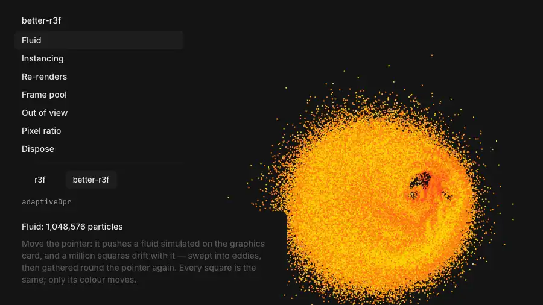
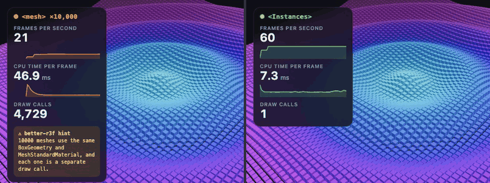
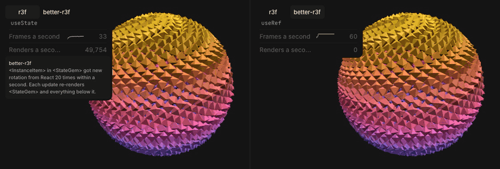
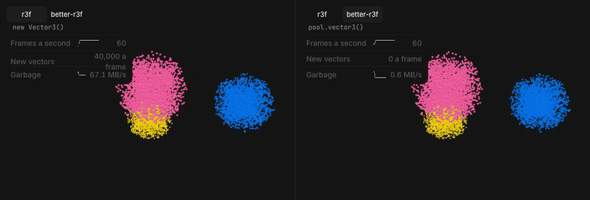
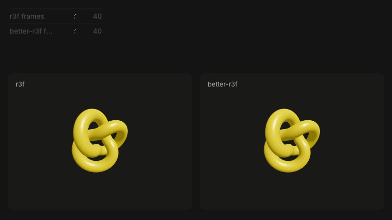
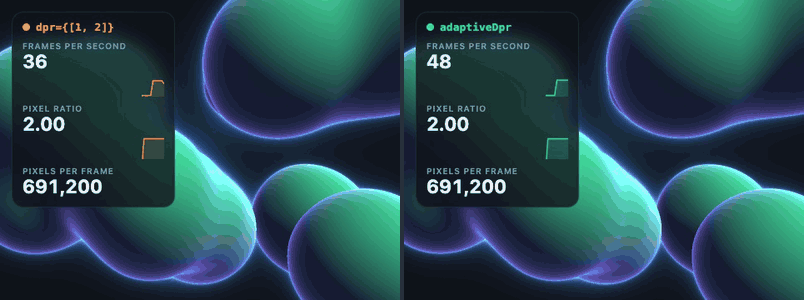
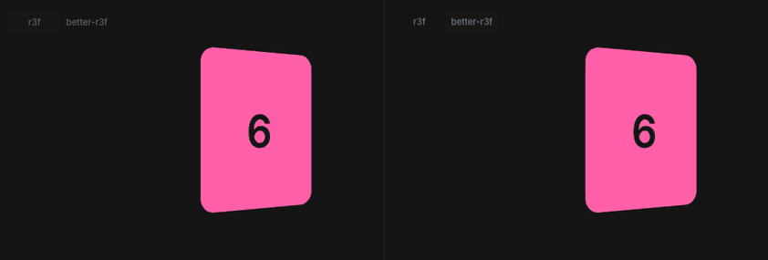

<h1 align="center">better-r3f</h1>

<p align="center">
  <b>react-three-fiber with the performance advice built in.</b><br />
  Same API, same JSX, same ecosystem. Six things every r3f performance guide tells you to do by hand, done by the
  renderer.
</p>

<p align="center">
  
</p>

<p align="center"><sub>The particle demos, one after another: a million squares in a fluid, 10,000 cubes, 1,600 gems, three swarms. The same particles travel from each formation into the next. <b><a href="https://kivzdev.github.io/better-r3f/">Open the live demos</a></b></sub></p>

---

better-r3f is a fork of [react-three-fiber](https://github.com/pmndrs/react-three-fiber) 9.8.1. Everything you know
from r3f works the same, imports stay `from '@react-three/fiber'`, and drei, rapier, postprocessing and the rest of the
ecosystem keep working. On top of that:

|                 | What the guides tell you                        | What better-r3f does                                                                                                   |
| --------------- | ----------------------------------------------- | ---------------------------------------------------------------------------------------------------------------------- |
| **Re-renders**  | Keep per-frame values in refs, not state        | Warns in development when an object gets new props from React on most frames, names the component and shows the fix    |
| **Instancing**  | Use `InstancedMesh` for many copies of one mesh | `<Instances>` and `<InstanceItem>` in core; they upload only what moved. Warns when many identical meshes could be one |
| **Allocations** | Don't `new THREE.Vector3()` inside `useFrame`   | `state.pool` hands out scratch vectors, matrices and colors that are recycled every frame                              |
| **On-demand**   | `frameloop="demand"` when nothing moves         | Stops rendering while the canvas is scrolled out of view or its tab is hidden. On by default                           |
| **Pixel ratio** | Cap it with `dpr={[1, 2]}`                      | `adaptiveDpr` lowers the pixel ratio while frames run slow and raises it again once they keep up                       |
| **Dispose**     | Dispose what you create yourself                | `useDisposable()` disposes hand-made geometries, materials, textures and render targets when they go away              |

## Contents

- [Install](#install)
- [1. Instancing](#1-instancing-instances)
- [2. Re-renders](#2-re-renders-a-hint-that-names-the-component)
- [3. Frame pool](#3-frame-pool-statepool)
- [4. Paused out of view](#4-paused-out-of-view)
- [5. Adaptive pixel ratio](#5-adaptive-pixel-ratio-adaptivedpr)
- [6. useDisposable](#6-usedisposable)
- [Development hints](#development-hints)
- [Run the demos](#run-the-demos)
- [How the GIFs were recorded](#how-the-gifs-were-recorded)
- [Differences from upstream](#differences-from-upstream)

## Install

better-r3f installs under the usual package name, so libraries that depend on `@react-three/fiber` use it too:

```bash
npm install three @react-three/fiber@https://github.com/kivzdev/better-r3f/releases/download/v9.8.1-better.2/react-three-fiber-9.8.1.tgz
```

It needs what r3f 9 needs: React 19 and three r156 or newer. Nothing to change in your code; the new features are opt-in
props, hooks and components, apart from [pausing out of view](#4-paused-out-of-view), which is on by default.

To build it yourself:

```bash
git clone https://github.com/kivzdev/better-r3f && cd better-r3f
yarn && yarn build
cd packages/fiber && npm pack   # react-three-fiber-9.8.1.tgz, install it like above
```

## 1. Instancing: `<Instances>`

<p align="center"></p>
<p align="center"><sub>10,000 cubes. Left: one <code>&lt;mesh&gt;</code> each, 15 fps, 65 ms a frame and about 5,200 draw calls. Right: <code>&lt;Instances&gt;</code>, 60 fps, 8 ms and 1 draw call.</sub></p>

Every `<mesh>` is a draw call. Ten thousand of them keep the main thread busy just telling the GPU what to draw.
`<Instances>` draws all of its items with one call, and each item is still a normal object you can position, color,
animate and click.

```jsx
import { Canvas, Instances, InstanceItem } from '@react-three/fiber'

function Cubes({ cubes }) {
  return (
    <Instances limit={cubes.length}>
      <boxGeometry />
      <meshStandardMaterial />
      {cubes.map((cube) => (
        <InstanceItem
          key={cube.id}
          position={cube.position}
          color={cube.color}
          onClick={(e) => console.log('clicked instance', e.instanceId)}
        />
      ))}
    </Instances>
  )
}
```

What it does beyond a plain `InstancedMesh`:

- **Only changed instances are uploaded.** Right before three.js draws, it compares each item with what the GPU already
  has and marks just the changed range for upload. A scene where nothing moves uploads nothing.
- **Culling stays correct.** The bounding sphere follows the instances as they move, so they are never culled by
  stale bounds. It is computed in the same pass, without three's per-instance sphere transforms.
- **Adding and removing is O(1).** An unmounted item swaps the last one into its slot. Mounting items doesn't
  re-render `<Instances>`.
- **Items are real objects.** Pointer events report `e.instanceId`, refs give you the object, children and nested groups
  work, and `Box3.setFromObject` measures them.

| `<Instances>` prop | Default | What it does                                                  |
| ------------------ | ------- | ------------------------------------------------------------- |
| `limit`            | `1000`  | How many items it has room for. Changing it rebuilds the mesh |
| `range`            | all     | Draw only the first n items                                   |
| any mesh prop      |         | `castShadow`, `frustumCulled`, `position`, events…            |

`<InstanceItem>` takes the props of a group plus `color`. Its ref is an `InstanceProxy` (a `THREE.Group` with
`.color` and `.instanceId`).

In development, a scene with 100 or more meshes sharing a geometry and material type gets a console hint:

```
[better-r3f] 10000 meshes use the same BoxGeometry and MeshStandardMaterial, and each one is a separate draw call.
<Instances> draws all of them in one:

  <Instances limit={10000}>
    <boxGeometry />
    <meshStandardMaterial />
    {items.map((item) => <InstanceItem key={item.id} position={item.position} color={item.color} />)}
  </Instances>
```

## 2. Re-renders: a hint that names the component

<p align="center"></p>
<p align="center"><sub>1,600 spinning gems. Left: <code>useState</code> in <code>useFrame</code>, about 31 fps and 50,000 React renders a second. Right: a ref, 60 fps and none.</sub></p>

Setting state in `useFrame` re-renders the component and everything below it on every frame. It works, so it is easy
to miss. better-r3f counts how often each object gets new props from React; when one gets them on most frames, it says
so once, with the component's name and the fix:

```
[better-r3f] <mesh> in <StateGem> got new rotation from React 20 times within a second. Each update re-renders
<StateGem> and everything below it.
For values that change every frame, write to the object in useFrame instead:

  const ref = useRef()
  useFrame((state, delta) => { ref.current.rotation.y += delta })
  <mesh ref={ref} />
```

```jsx
// Before: 60 React renders a second per gem
function Gem() {
  const [angle, setAngle] = useState(0)
  useFrame((_, delta) => setAngle((angle) => angle + delta))
  return <mesh rotation={[angle, angle, 0]} />
}

// After: React renders it once
function Gem() {
  const ref = useRef()
  useFrame((_, delta) => {
    ref.current.rotation.x += delta
    ref.current.rotation.y += delta
  })
  return <mesh ref={ref} />
}
```

Event handlers that are new on every render don't count, and animation libraries that write to objects directly (like
react-spring) never trigger it.

## 3. Frame pool: `state.pool`

<p align="center"></p>
<p align="center"><sub>10,000 steering particles, 4 temporary vectors each per frame. Left: <code>new THREE.Vector3()</code>, 40,000 new vectors a frame, about 66 MB of garbage a second. Right: <code>pool.vector3()</code>, none, and 0.2 MB a second from everything else.</sub></p>

`state.pool` hands out vectors, quaternions, matrices, colors, boxes, spheres, rays and planes. Everything it hands out
is recycled before the next frame, so per-frame math allocates nothing after the first frame.

```jsx
useFrame(({ pool }, delta) => {
  // Before: two new objects per particle per frame
  // const toTarget = new THREE.Vector3().subVectors(target, p.position)

  const toTarget = pool.vector3().subVectors(target, p.position).normalize()
  const turn = pool.quaternion().setFromUnitVectors(forward, toTarget)
  p.quaternion.slerp(turn, delta * 4)
})
```

Each call returns a reset object (zero vector, identity quaternion and matrix, white color, empty box), or one set to
the arguments: `pool.vector3(x, y, z)`, `pool.color('hotpink')`. Use pooled objects inside the callback that took them;
to keep a value, copy it into an object you own.

Honest numbers: on the M4 used for the GIF both versions hold 60 fps, and the update itself costs about the same
(1 ms for 48,000 vectors either way, measured in Node). What changes is the garbage: about 66 MB a second for the
collector to clean up, versus almost none. Those collections are what show up as dropped frames on slower phones.

`pool.stats` reports how many objects the current frame took and how many the pool holds. r3f's own
[`no-new-in-loop`](https://github.com/kivzdev/better-r3f/blob/master/packages/eslint-plugin/docs/rules/no-new-in-loop.md) lint rule now suggests the pool too.

## 4. Paused out of view

<p align="center"></p>
<p align="center"><sub>The same scene twice. Scrolled out of view, the left canvas (r3f's behavior) keeps drawing 60 frames a second; better-r3f draws none until it is back.</sub></p>

A canvas with `frameloop="always"` renders every frame, even after it has been scrolled away: a landing page with a 3D
hero keeps the GPU busy while the reader is three sections further down. better-r3f watches the canvas with an
`IntersectionObserver` and the page's visibility:

- out of view, or in a hidden tab, the root skips its frames: no `useFrame` callbacks, no rendering;
- back in view, it renders a fresh frame right away and carries on;
- the time spent paused is skipped, so animations driven by `delta` or the clock continue where they stopped instead of
  jumping.

It is on by default. To get r3f's behavior back, for example when something must keep running in `useFrame` while
nobody can see the canvas:

```jsx
<Canvas pauseWhenOffscreen={false}>
```

Invalidations while paused (`frameloop="demand"`) are kept and rendered once the canvas is back. WebXR sessions and
manual `advance()` calls are never paused.

## 5. Adaptive pixel ratio: `adaptiveDpr`

<p align="center"></p>
<p align="center"><sub>A scene that's heavy per pixel, on a 2× screen. Left: <code>dpr={[1, 2]}</code> stays at 2 and runs at about 34 fps. Right: <code>adaptiveDpr</code> steps down to 1.5 and runs at 60 fps.</sub></p>

On a 2× screen, pixel ratio 2 means four times the pixels of 1. Capping it with `dpr={[1, 2]}` helps on 3× phones, but a
scene that is too heavy at 2 stays too heavy. `adaptiveDpr` measures frame times and moves the ratio within your range:

```jsx
<Canvas dpr={[1, 2]} adaptiveDpr>
<Canvas dpr={[1, 2]} adaptiveDpr={{ min: 0.75, targetFps: 120 }}>
```

- A second below 90% of the target frame rate steps the ratio down by `step`.
- Two seconds at the target step it back up.
- A ratio that can't hold the frame rate right after a step up isn't tried again for 30 seconds, then twice as long each
  time it fails, so the canvas doesn't flicker between two resolutions. Once it holds, the wait resets.
- Long gaps (a hidden tab, a breakpoint) don't count as slow frames, and the first second after loading is ignored.

| Option      | Default                               | What it does             |
| ----------- | ------------------------------------- | ------------------------ |
| `min`       | low end of `dpr` (1 for `[1, 2]`)     | Lowest ratio it drops to |
| `max`       | what `dpr` resolves to on the display | Highest ratio            |
| `targetFps` | `60`                                  | Frame rate to hold       |
| `step`      | `0.25`                                | Change per step          |

It needs `frameloop="always"`; with `demand` there are no steady frame times to measure. `viewport.dpr` always holds the
current value. In development, a pixel ratio above 2 gets a hint.

## 6. `useDisposable`

<p align="center"></p>
<p align="center"><sub>A card with a hand-made texture and geometry, swapped every 120 ms. Left: <code>useMemo</code>, textures and geometries pile up on the GPU. Right: <code>useDisposable</code>, one of each.</sub></p>

r3f disposes what you declare in JSX when it unmounts. It doesn't dispose objects you create yourself and pass in as
props, because it can't know whether something else still uses them. Those stay on the GPU until the page closes.
`useDisposable` is `useMemo` that disposes:

```jsx
import { useDisposable } from '@react-three/fiber'

function Label({ text }) {
  // Before: useMemo(() => ..., [text]) leaked a texture every time text changed
  const texture = useDisposable(() => makeTextTexture(text), [text])
  return (
    <sprite>
      <spriteMaterial map={texture} />
    </sprite>
  )
}

// Several resources at once: everything with dispose() in an object or array is disposed
const { geometry, target } = useDisposable(
  () => ({ geometry: new THREE.TorusKnotGeometry(1, 0.3, segments), target: new THREE.WebGLRenderTarget(512, 512) }),
  [segments],
)
```

The old value is disposed when a dependency changes and the last one when the component unmounts. It doesn't walk into
three objects, so disposing a mesh you made leaves a shared geometry or material alone. `disposeValue(value)` is the
same disposal as a plain function.

## Development hints

The hints only print in development builds, each once. Turn them off together or one by one:

```js
import { setWarnings } from '@react-three/fiber'

setWarnings(false)
setWarnings({ instancing: false })
```

| Hint         | When                                                                 |
| ------------ | -------------------------------------------------------------------- |
| `hotProps`   | An object gets new props from React 20 times within a second         |
| `instancing` | 100 or more visible meshes share a geometry setup and material type  |
| `dpr`        | The pixel ratio resolves above 2                                     |
| `pool`       | The frame pool hands out 100,000 objects of one kind without a reset |

## Run the demos

Every GIF above is a page of the example app, with a switch between the two versions. They're live at
**[kivzdev.github.io/better-r3f](https://kivzdev.github.io/better-r3f/)**, or locally:

```bash
yarn
yarn examples
```

Then open `/demo/BetterFluid`, `BetterInstancing`, `BetterRerenders`, `BetterPool`, `BetterOffscreen`,
`BetterAdaptiveDpr` or `BetterDispose` (add `?mode=classic` or `?mode=better`). The first four are one scene with one
set of particles: moving from one to the next, every particle travels to its place in the next formation, and `?tour`
walks through them on its own. The source is in [`example/src/demos/better`](https://github.com/kivzdev/better-r3f/tree/master/example/src/demos/better).

## How the GIFs were recorded

Headless Chrome 157 on an Apple M4 Mac, production build of the example app, 560×380 at a 2× pixel ratio, with
`?record`, which keeps only the switch and the numbers on the panel. Each side of a comparison was recorded on its own,
so the two never shared the CPU or GPU. The CPU-bound comparisons (instancing, re-renders, frame pool) ran with Chrome
DevTools' 4× CPU slowdown, which stands in for a mid-range phone. Without it the M4 held 56–60 fps in all three, and
the difference showed up as main-thread time instead: about 17 ms versus 5 ms per frame for the instancing scene. At
that size the pixel ratio scene holds 60 fps even at 2×, so its GIF uses a heavier version of it
(`?balls=64&steps=400&march=0.25`). The animation at the top is `/demo/BetterFluid?tour` at 900×506, with the pointer
stirring the fluid. The numbers are from those runs and will differ on your machine.

## Differences from upstream

- New exports: `Instances`, `InstanceItem`, `InstancesMesh`, `InstanceProxy`, `useDisposable`, `disposeValue`,
  `setWarnings`, `AdaptiveDprController` and their types.
- New `<Canvas>` / `configure()` props: `adaptiveDpr`, `pauseWhenOffscreen` (web only).
- `RootState` has `pool`; `state.internal` has `offscreen` and `adaptiveDpr`.
- Changed default: canvases pause while out of view. `pauseWhenOffscreen={false}` restores r3f's behavior.
- All of r3f's own tests pass (the public API snapshot now lists the new exports); the additions have their own in
  [`packages/fiber/tests/better.test.tsx`](https://github.com/kivzdev/better-r3f/blob/master/packages/fiber/tests/better.test.tsx). The new code lives in
  [`packages/fiber/src/core/better`](https://github.com/kivzdev/better-r3f/tree/master/packages/fiber/src/core/better), which keeps the fork easy to rebase onto
  upstream.

## Credits and license

better-r3f is a fork of [react-three-fiber](https://github.com/pmndrs/react-three-fiber) by
[Poimandres](https://github.com/pmndrs) and its contributors. For everything that isn't listed above, the
[r3f documentation](https://r3f.docs.pmnd.rs) applies. MIT licensed, like the original; see [LICENSE](https://github.com/kivzdev/better-r3f/blob/master/LICENSE).

The fork is maintained by [@kivzdev](https://github.com/kivzdev).
